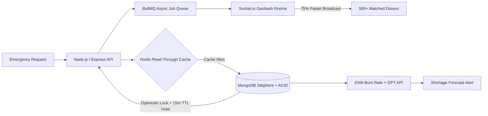
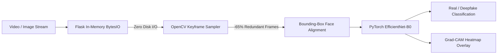

<div align="center">

  <!-- STATUS PILLS (SHIELDS.IO - 100% UPTIME) -->
  <p align="center">
    
    
  </p>

  <!-- NATIVE HERO HEADER (ZERO EXTERNAL IMAGE DEPENDENCIES) -->
  <h1>Hi, I'm Prashant 👋</h1>
  <h3><b>Full-Stack & Applied AI Engineer  |  Low-Latency Distributed Systems</b></h3>

  <br/><br/>

  <!-- FIXED ANIMATED TYPING TERMINAL (ASCII-SAFE FOR GITHUB CAMO) -->
  <a href="https://github.com/Prashant88123">
    
  </a>

  <br/>

  <!-- SOCIAL & PROOF BADGES (SHIELDS.IO - 100% UPTIME) -->
  <p align="center">
    <a href="mailto:sprashant1103@gmail.com">
      
    </a>
    <a href="https://linkedin.com/in/prashantss1" target="_blank">
      
    </a>
    <a href="https://github.com/Prashant88123" target="_blank">
      
    </a>
    <a href="https://leetcode.com/" target="_blank">
      
    </a>
    <a href="https://codeforces.com/" target="_blank">
      
    </a>
  </p>
</div>

---

### ⚡ Engineering Snapshot (`whoami`)

```yaml
name: Prashant
role: Software Development Engineer (Full-Stack, Backend & Applied AI)
education: B.Tech in Computer Science & Engineering (2023 – 2027)
core_focus:
  - High-Concurrency Distributed Web Systems (MongoDB ACID, Optimistic Locking, Redis, BullMQ, Socket.io)
  - Applied AI & LLM Automation (LangChain, OpenAI/GPT API, Python AST Code Analysis, Prompt Engineering)
  - Computer Vision Inference (PyTorch, EfficientNet-B0, OpenCV, In-Memory Byte-Stream APIs, Grad-CAM)
  - Algorithmic Problem Solving (800+ Problems Solved across LeetCode & Codeforces in C++)
```

---

### 🚀 Flagship Production Systems & Impact

<table>
  <tr>
    <td width="50%" valign="top">
      <h3 align="center">🩸 RaktSetu</h3>
      <p align="center"><b>Real-Time Blood Donation & Emergency Dispatch Network</b></p>
      <p align="center">
        
        
        
        
        
        
        
      </p>
      <ul>
        <li><b>12ms Spatial Query Latency (-70% search time):</b> Engineered a GeoJSON <code>2dsphere</code> spatial indexing pipeline with blood-group compatibility matching, 90-day eligibility filtering, and Leaflet routing.</li>
        <li><b>Zero Inventory Race Conditions (-60% manual ops):</b> Implemented MongoDB <b>ACID transactions</b> with optimistic concurrency locking and 15-minute TTL reservation holds to prevent double-booking.</li>
        <li><b>75% Faster Broadcast Latency:</b> Built a hybrid EMA burn-rate + GPT API shortage forecasting engine backed by Redis read-through caching and BullMQ/Socket.io geohash rooms across <b>500+ matched donors</b>.</li>
      </ul>
      <p align="center">
        <a href="https://github.com/Prashant88123"></a>
        <a href="https://github.com/Prashant88123"></a>
      </p>
    </td>
    <td width="50%" valign="top">
      <h3 align="center">🔍 DeepSight</h3>
      <p align="center"><b>AI-Powered Deepfake & Media Forensics Engine</b></p>
      <p align="center">
        
        
        
        
        
        
      </p>
      <ul>
        <li><b>End-to-End Forensics Pipeline:</b> Engineered a media manipulation detector using <code>EfficientNet-B0</code> (trained on <b>FaceForensics++</b>) across uploaded images and video streams.</li>
        <li><b>65% Lower Frame-Inference Overhead:</b> Optimized video preprocessing with OpenCV via automated keyframe sampling and bounding-box facial alignment.</li>
        <li><b>Zero Disk I/O Bottlenecks:</b> Architected a low-latency Flask REST API using in-memory byte-stream decoding (<code>BytesIO</code>), generating <b>Grad-CAM heatmap overlays</b> on manipulated facial regions.</li>
      </ul>
      <p align="center">
        <a href="https://github.com/Prashant88123"></a>
      </p>
    </td>
  </tr>
</table>

---

### 🏗️ System Architecture Highlights (Rendered Natively on GitHub)

<details open>
<summary><b>🩸 RaktSetu — Low-Latency Spatial Dispatch & Concurrency Pipeline (Click to toggle)</b></summary>
<br/>


</details>

<details>
<summary><b>🔍 DeepSight — In-Memory Video Forensics & Grad-CAM Inference Pipeline (Click to toggle)</b></summary>
<br/>


</details>

---

### 💼 Industry Experience

#### **Infosys Springboard Internship 6.0** — *AI Software Engineering Intern (Remote)* `Nov 2025 – Jan 2026`
- **Project:** **AI-Powered Code Reviewer** (`Python` • `Abstract Syntax Trees (AST)` • `LangChain` • `LLM APIs` • `Prompt Engineering` • `Streamlit`)
- **40% Reduction in Manual Review Time:** Built an automated code analysis engine that detects logical, structural, and syntactic issues across Python codebases.
- **AST Parse-Tree + LLM Pipeline:** Leveraged Abstract Syntax Trees to parse structural code context prior to LLM inference, cutting code review turnaround from hours to minutes.

---

### 🛠️ Production Tech Stack

<div align="center">

| Layer | Technologies |
| :--- | :--- |
| **Languages** |      |
| **Frontend** |       |
| **Backend & Systems** |        |
| **AI / ML & Vision** |      |
| **Databases & Tools** |       |

</div>

---

### 🏆 Certifications & Algorithmic Benchmarks

| Benchmark / Credential | Issuing Body / Platform | Focus Area |
| :--- | :--- | :--- |
| **600+ Problems Solved** | **LeetCode** | Arrays, Graphs, Dynamic Programming, Trees (C++) |
| **200+ Problems Solved** | **Codeforces** | Competitive Algorithmic Problem Solving (C++) |
| **OCI 2025 Certified Generative AI Professional** | **Oracle** | Large Language Models, RAG, OCI GenAI Service |
| **OCI 2025 Certified AI Foundations Associate** | **Oracle** | Machine Learning, Deep Learning & AI Foundations |
| **Infosys Springboard Internship 6.0 Certificate** | **Infosys** | AI-Powered Code Reviewer (Python, AST, LangChain) |

---

<div align="center">
  <h3>🤝 Building Something Ambitious? Let's Talk.</h3>
  <p>
    <a href="mailto:sprashant1103@gmail.com"></a>
    <a href="https://linkedin.com/in/prashantss1"></a>
  </p>
</div>
